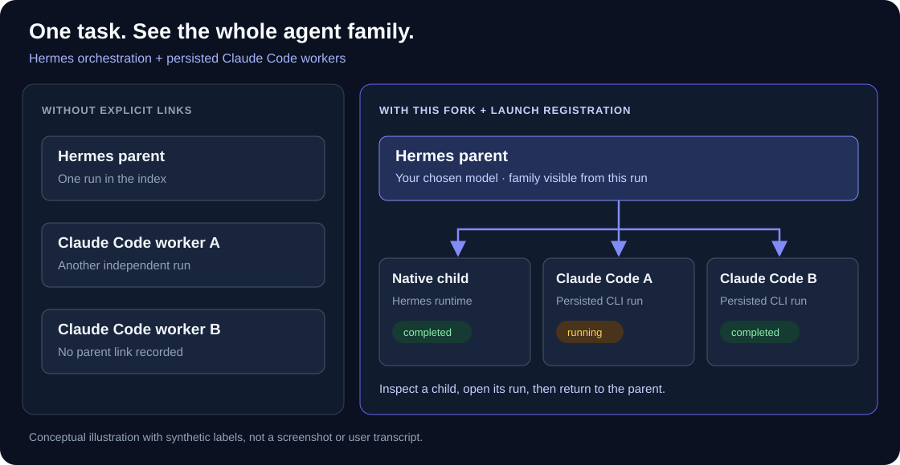

# RunGraph for Hermes agent families

**See the agents your agent called, together in one graph.**

[](https://github.com/marzliak/rungraph/actions/workflows/ci.yml)
[](LICENSE)

[Quick start](#quick-start) · [Setup and limits](docs/HERMES_FAMILIES.md) · [Share this project](docs/SHARE.md)

Your Hermes agent launches several Claude Code workers. They do the work, but
independent run entries don't tell you which parent launched them. You end up
switching filters and opening sessions one at a time.

This fork adds explicit parent/child links for those persisted launches. Open the
Hermes parent and see its native children and registered Claude Code workers in
the same execution graph, even when they use different models.



*Illustration with synthetic labels. It is not a screenshot or a user transcript.*

## What this fork adds

| Without the integration | With this fork and launch registration |
|---|---|
| External Claude Code workers appear as separate runs | Workers appear connected to their Hermes parent; standalone runs still exist |
| Selecting Hermes doesn't establish a link to an external worker | Open the parent under the Hermes filter and keep its registered children in view |
| Recent transcript activity can be mistaken for execution | `running` requires runtime evidence; missing evidence becomes `unknown` |
| A new worker has no transcript yet | A connected placeholder remains visible until the transcript is discovered |

You can inspect a child, see its requested model when recorded, open its own run,
and navigate back to its parent. You don't need to change the parent's model or
provider. This is an observer integration, not a new agent orchestrator.

### Is it still running?

The integration separates activity from evidence:

- `running`: verified process/worker evidence or a verified running linked child.
- `completed` / `error`: a recorded terminal outcome, where available.
- `unknown`: missing, stale or contradictory runtime evidence.
- `recent`: transcript recency without execution proof; it is not a live claim.

A quiet transcript alone doesn't prove that work finished. Process checks use
Linux `/proc`, including process start time and boot identity, to avoid mistaking
a recycled PID for the original worker. On platforms without that evidence,
execution state can remain `unknown`.

## Quick start

Use **Node.js ≥ 22.13** for Hermes SQLite support. The optional launcher also
requires **Python ≥ 3.10** and your existing Claude Code installation.

```bash
git clone --branch homolog https://github.com/marzliak/rungraph.git
cd rungraph
npm ci
npm run build
node bin/rungraph.js
```

This opens the local viewer. To connect new external workers, follow the
[launcher and registry setup](docs/HERMES_FAMILIES.md#connect-new-claude-code-workers).
Just installing the viewer does **not** retroactively establish their parentage.

**`npx rungraph` installs the upstream npm package, not this fork's integration.**
Use the source checkout above for these additions.

## Scope and privacy

- The WebUI composes families using exact session IDs. It doesn't infer ownership
  from task names or timestamps. CLI/MCP parsing retains its upstream native scope.
- The optional launcher links persisted headless `claude -p` / `--print` runs
  with a valid inherited `HERMES_SESSION_ID`. Interactive runs, anonymous calls
  and `--no-session-persistence` transports pass through without links.
- Existing unregistered external runs stay independent. Historical import requires
  the specific launcher ledger and exact proof; it is not general auto-discovery.
- Registry files omit task prompts but contain private metadata, including
  session IDs, labels and working directories. Keep them and transcripts private.
- The viewer is local by default. Don't expose it publicly without your own
  authentication and network controls. Publishing this source does not publish
  your agent conversations.

See [the integration guide](docs/HERMES_FAMILIES.md) for exclusions and setup,
and [SECURITY.md](SECURITY.md) before sharing a run or reporting a security issue.

## Try it and share what breaks

If you use Hermes with external Claude Code workers, try this fork with a small
local task. Report reproducible problems in
[Issues](https://github.com/marzliak/rungraph/issues); don't attach raw transcripts
or private registry files. A useful report names the versions, expected behavior
and a sanitized example.

If this solves a problem for you, **star the repo** so you can find it again.
[Short descriptions](docs/SHARE.md) are ready to share.

## Built on RunGraph

This is a focused fork of [Fayzan Malik's RunGraph](https://github.com/fayzan123/rungraph),
based on upstream v0.8.1. The original graph viewer, transcript adapters and MIT
license remain credited to that project. These additions are not an upstream
release and do not imply endorsement by the original author.

The sections below describe the upstream features. Its interactive demo and GIF
use upstream data and do **not** demonstrate this fork's execution-family feature.

**Ask your agent what happened. Watch the graph answer.**
[fayzan123.github.io/rungraph](https://fayzan123.github.io/rungraph/) embeds a
real run you can click around.


Your agent already wrote down everything it did. `rungraph` turns those
transcripts into an interactive graph — orchestrator, subagents and tools as
nodes, spawn/return edges, the moments a human said no marked on the path — and
hands your agent the same graph over MCP. Ask *"why did the Edit on `token.js`
keep failing?"* in your terminal: the answer arrives there, from your own model,
and the graph you have open **lights up the exact nodes the answer is about**.

```
npx rungraph
```

That's the whole quickstart. It finds every Claude Code, Codex, Hermes Agent,
opencode and Cursor run still on your disk, starts a local server and opens
your browser. No hooks, no wrappers, no telemetry — it works retroactively, and
a run that's happening right now grows live as the agent works.

> Hermes, opencode and Cursor runs need Node ≥ 22.13 for the built-in SQLite
> reader. On older Nodes they're skipped with a warning; everything else works.

**New here?** [docs/GUIDE.md](docs/GUIDE.md) walks through reading the graph,
what each signal means, wiring it to your agent, and what to do when something
looks broken.

## What you see

- **Time flows down.** Your prompts are the backbone; parallel agents fan out
  into lanes and return to the turn that collected their result.
- **Tool nodes say what ran:** `Bash · npm test ×12`, `Edit · canvas.jsx`.
  Consecutive calls of the same tool collapse into one node, so a test-fix loop
  isn't a hairball.
- **Click any node** for the full story — prompt and response for turns; every
  call's inputs, outputs, errors and timing for tools; the complete transcript
  for subagents; and the agent's own narration from just before a call.
- **Human interventions are nodes.** A denied permission, an answered question,
  an interrupt — and the edges after them carry the reason (`after permission
  denial`, `retry after failure`).
- **Workflow runs** appear as single nodes you can drill into, phase boxes and
  all.
- **Tokens, durations and models** annotate nodes; whole-run totals in the
  header.

## What went wrong

A graph that renders everything with equal weight points at nothing, so
rungraph has an opinion. It derives **signals** from the run and puts them in a
strip above the canvas — and on a clean run the strip costs zero height,
because a marker you can't trust is worse than no marker.

| | fires when |
|---|---|
| ⟳ **retry storm** | the same tool kept failing in one place |
| ⚠ **unresolved error** | something failed and nothing ever came back to fix it |
| ✋ **intervention** | you denied a permission, interrupted a turn, or answered a question |
| ◆ **outlier** | a step that cost far more tokens or wall-clock than the rest of the run |
| ⚑ **course change** | the run's own recorded reason for changing direction |

Click a signal and the graph **focuses**: those nodes light up, everything
else dims — never hides, so the shape you already memorized stays put. The
same focus backs **find** (`/`, substring over labels *and the files each node
touched*, no model or network), **files** (click any path the run touched,
subagent work included, to see the steps behind it), and your agent's answers.
Signals re-derive on every live update, so the strip goes loud only when
something new has actually gone wrong.

Every run also carries **coverage** — how many records rungraph examined and
how many it couldn't interpret. Transcript formats are undocumented and
unversioned; when a vendor adds a record type, the strip says `read 95% of this
run` and names what it didn't understand, instead of letting an empty strip
pass for a clean run. Your agent gets the same numbers.

## Ask your agent about a run

```
npx rungraph mcp --install     # one time, then restart your agent
npx rungraph mcp --check       # is it working? prints exactly what to fix
```

Bare `--install` registers with every agent whose runs rungraph has already
read — Claude Code, Codex, Hermes, opencode, Cursor — by delegating to each
vendor's own `mcp add`; it never edits a config file itself. Where it can't
delegate (`cursor-agent mcp` has no `add`) it prints the block to paste and a
`cursor://` install link. `--client <name>` targets one agent, `--client all`
does all five. [GUIDE §6](docs/GUIDE.md#6-ask-your-agent) has the full
walkthrough; the `--json` shapes are in [SCHEMA.md](SCHEMA.md#mcp-rungraph-mcp).

Then ask the kinds of questions a transcript can actually answer:

- *which edits in my last run failed — and did any stay broken?*
- *which steps touched `src/auth.js`, subagents included?*
- *what did the "audit auth module" agent find?*
- *did it actually run the tests, or just say it did?*

Your agent calls `find_nodes` / `get_graph` / `get_detail` and **answers in
your terminal** — your model, your session, fully inspectable. Then it calls
`focus_nodes`, and **the open dashboard lights up the nodes the answer is
about**, switching runs or opening a tab if it has to, and hands back a deep
link you can paste into a PR. The inspector writes starter questions for you
from the run you're looking at.

| tool | does |
|---|---|
| `list_runs` | the run index |
| `get_graph` | one run's graph, compact by default (signals + files + coverage) |
| `find_nodes` | narrow before you pull — a big graph is 20k+ tokens |
| `get_detail` | the actual error text behind one node |
| `focus_nodes` | light up the open dashboard; returns a pastable deep link |
| `get_current_view` | what the dashboard is showing right now |
| `open_visualization` | open the browser on a run |

The read-only tools work with no server running. With more than one dashboard
live — yours plus a bundle someone sent you — the tools route by run id.

## Sharing a run

```
rungraph export --last 2 --as Bilal
# rungraph: export inventory (full content):
#   2 runs · 143 nodes · 12 of your prompts included
#   files touched: 24
# rungraph: wrote acme-2026-08-15.rungraph (412,882 bytes)
```

The inventory prints every time, because transcripts log file **reads**
verbatim: when an agent merely opens your `.env`, every key it saw is sitting
in the session file with no diff to catch it. Export **blocks** on
high-confidence secrets (AWS keys, GitHub/Slack/API tokens, private-key
blocks), naming where each one is. Resolve with `--redact-secrets`,
`--structure-only` (shape, tool names, files and timings — no prompts, no
outputs), or `--allow-secrets`. *share…* in the runs pane does the same from
the dashboard.

Send the `.rungraph` file over whatever you already trust; rungraph never
touches a network. The recipient runs `npx rungraph open team-work.rungraph`:
an ephemeral dashboard, nothing copied, every run labelled *shared by Bilal*,
and their own agent can be asked about your runs. Bundles carry the
vendor-neutral IR, so a Codex run opens identically to a Claude Code one.

*copy link* in the header — and `focus_nodes` — produce a URL that restores the
run, selection and focus; a link that lands on the wrong dashboard offers a
jump to the one that has the run.

## Getting around

| Input | Action |
|---|---|
| Two-finger scroll / click-drag | Pan |
| Pinch / cmd+scroll | Zoom at the cursor |
| Click node or edge | Inspect it |
| Double-click node | Zoom to 100%, centered |
| `j` / `k` | Walk nodes in run order, inspector follows |
| `f` | Fit the whole graph |
| `/` | Find by label or file |
| `r` | Open / close replay |
| `←` / `→` | Step one event (replay open) |
| `space` | Play / pause (replay open) |
| `Esc` | Deselect and clear the focus (pauses replay, never closes it) |

A **minimap** shows the whole run with errors as red beacons, and `r` opens a
**replay** bar: scrub or play the run and watch the graph happen, with your
agent's `focus_nodes` moving the playhead to the moment its answer was true.
The **runs pane** groups sessions by project, filters by agent and by title,
and gathers runs with no project (deleted worktrees, home-directory chats)
under `✦ loose runs`.

**Resume from the dashboard:** every local run carries the exact
`claude --resume` / `codex resume` / `hermes --resume` / `opencode --session` /
`cursor-agent --resume` command, or on macOS opens a Terminal window with the
session loading (`RUNGRAPH_TERMINAL=iTerm` for iTerm2). A live Claude run
pre-checks **fork** so you don't interleave with the running session.

## For agents

Everything the UI can do, an agent can do over the CLI — JSON on stdout, logs
on stderr, exit codes `0` ok / `1` error / `2` no runs found, no prompts:

```bash
npx rungraph list --json                          # run index
npx rungraph graph <runId> --json                 # full Graph IR: nodes, edges, signals, coverage
npx rungraph find <runId> token.js --json         # narrow first — a big graph is 20k+ tokens
npx rungraph serve --no-open                      # {"url":"http://127.0.0.1:4321"}, SSE live tail
```

The IR is versioned, vendor-neutral and documented in [SCHEMA.md](SCHEMA.md).
Everything downstream — UI, CLI, HTTP API, bundles — consumes only the IR.

| adapter | reads | point it elsewhere |
|---|---|---|
| Claude Code | `~/.claude/projects` — sessions, subagents, Workflow runs | |
| Codex CLI | `~/.codex/sessions` — rollout threads and spawned subagents | |
| Hermes Agent | `~/.hermes/state.db` | `RUNGRAPH_HERMES_HOME` |
| opencode | `~/.local/share/opencode/opencode.db` (`XDG_DATA_HOME` honoured) | `RUNGRAPH_OPENCODE_HOME` |
| Cursor IDE | `~/Library/Application Support/Cursor/User/globalStorage/state.vscdb` (macOS) | `RUNGRAPH_CURSOR_GLOBAL_STORAGE` |
| `cursor-agent` | `~/.cursor/chats` (`CURSOR_DATA_DIR` honoured) | `RUNGRAPH_CURSOR_CLI_HOME` |

The SQLite stores are read with Node's built-in `node:sqlite` — readonly, live,
no dependency added. The Cursor adapter skips cloud agents (not local), lists
but doesn't parse pre-`_v:9` conversations (shown as 0% read), offers no
resume for IDE conversations, and reports no token totals because Cursor
records none; Linux and Windows IDE paths are unverified.

Built to survive real transcripts: unknown record types are skipped and
counted, never a crash; a half-written last line is retried on the next tick;
liveness comes from watching the run's own files, with stable node ids so
deltas merge. Zero runtime dependencies; the frontend ships prebuilt.

## Privacy

Everything is local. The server binds `127.0.0.1` only and every request is
Host-header-guarded, so a hostile page can't DNS-rebind its way into your
transcripts. rungraph makes no network requests.

Content leaves the machine at exactly two boundaries, and both redact:
`rungraph export` prints an inventory and hard-stops on detected secrets; the
MCP server redacts every tool result on the way out — node labels included —
and reports how many values it replaced, so a redacted run is never mistaken
for a clean one. The dashboard shows the real values: they never leave
loopback, and reading a key is how you rotate it.

## CLI reference

```
rungraph                       scan, serve, open browser (human default)
rungraph list [--json]         run index, newest first
rungraph graph <runId>         Graph IR for one run (JSON on stdout)
rungraph find <runId> <query>  nodes whose label or files match a substring
rungraph serve [--no-open]     start server; prints {"url": …}
rungraph export <runId…>       write a shareable .rungraph bundle (see --help)
rungraph open <bundle…>        serve bundle files, ephemerally
rungraph mcp [--install]       MCP server on stdio; --install registers it once
rungraph mcp --check           verify the agent side end to end
  --project <path>             only runs for this project directory
  --port <n>                   preferred port (auto-increments if taken)
  --last <n>                   export: the n most recent runs of this project
  --client <c>                 mcp --install: claude | codex | hermes | opencode | cursor | all
                               (default: every agent detected on this machine)
  --scope <s>                  mcp --install --client claude: user (default) | project | local
```

Requires Node ≥ 20.

## Roadmap

- **Annotations** — mark nodes before exporting a bundle.
- **Cross-run questions** — "what else touched this file?"
- **Run comparison** — diff two runs of the same task.
- **Cost estimates** — per-node tokens into dollars.

## Contributing

Adapters for other agent CLIs are the most valuable thing you can add; bug
reports with a `--structure-only` bundle attached are the most useful kind.
[CONTRIBUTING.md](CONTRIBUTING.md) has the repo map and the non-negotiables.
Security reports: [SECURITY.md](SECURITY.md), privately please.

## License

[MIT](LICENSE)
